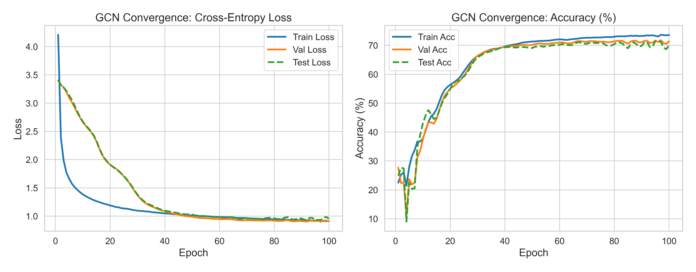
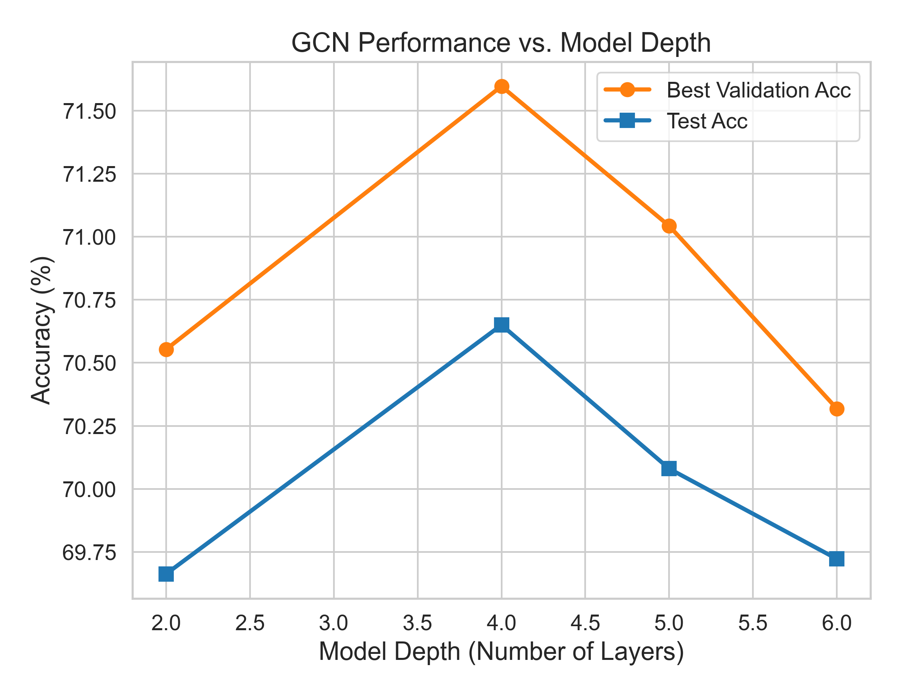
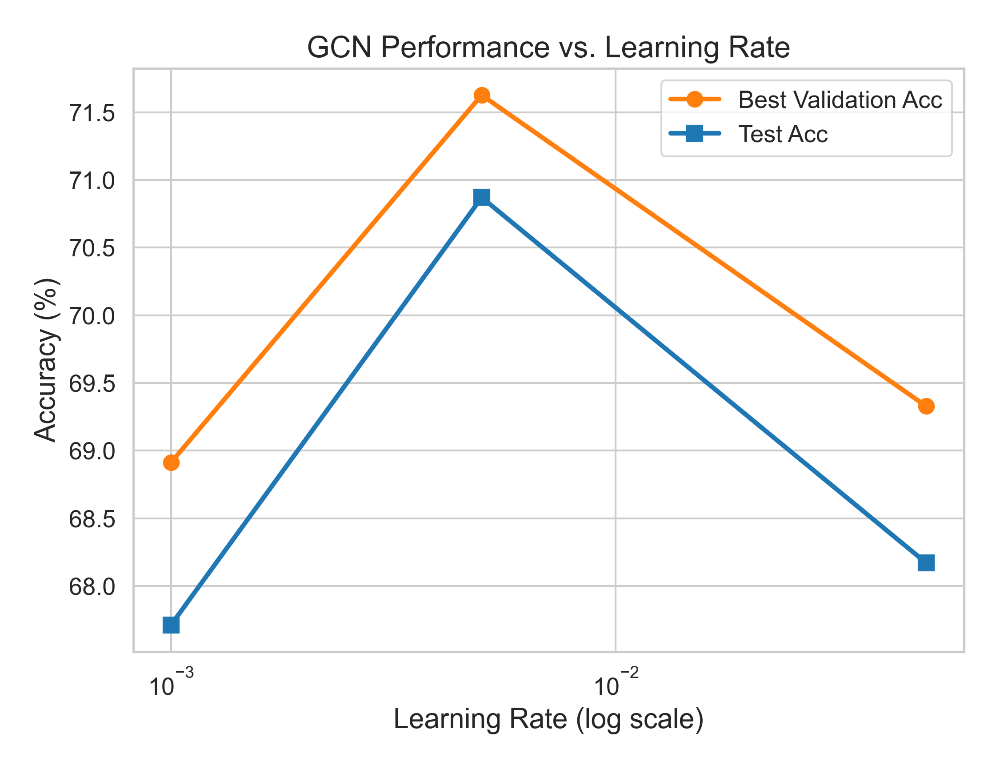
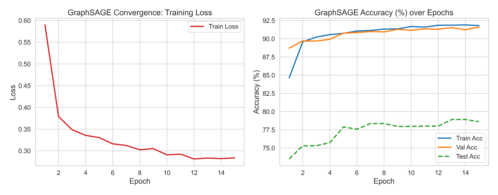
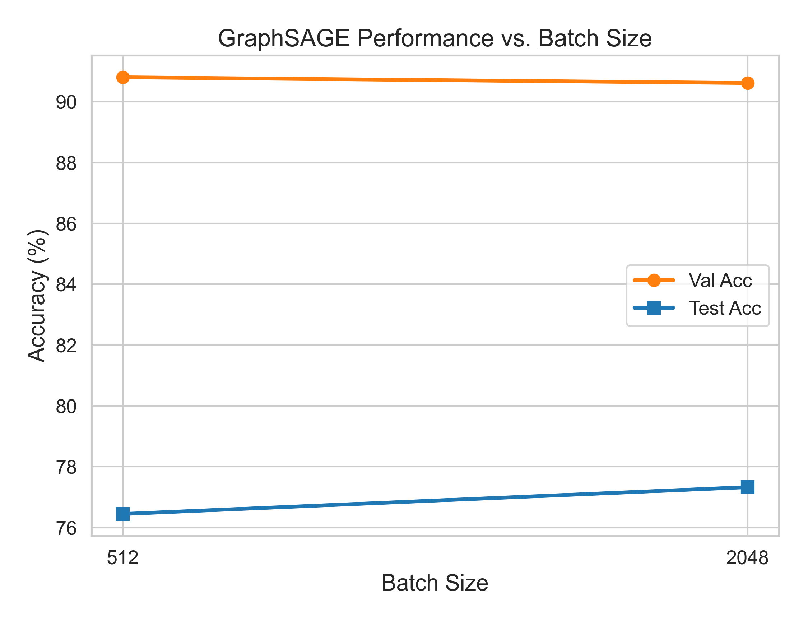
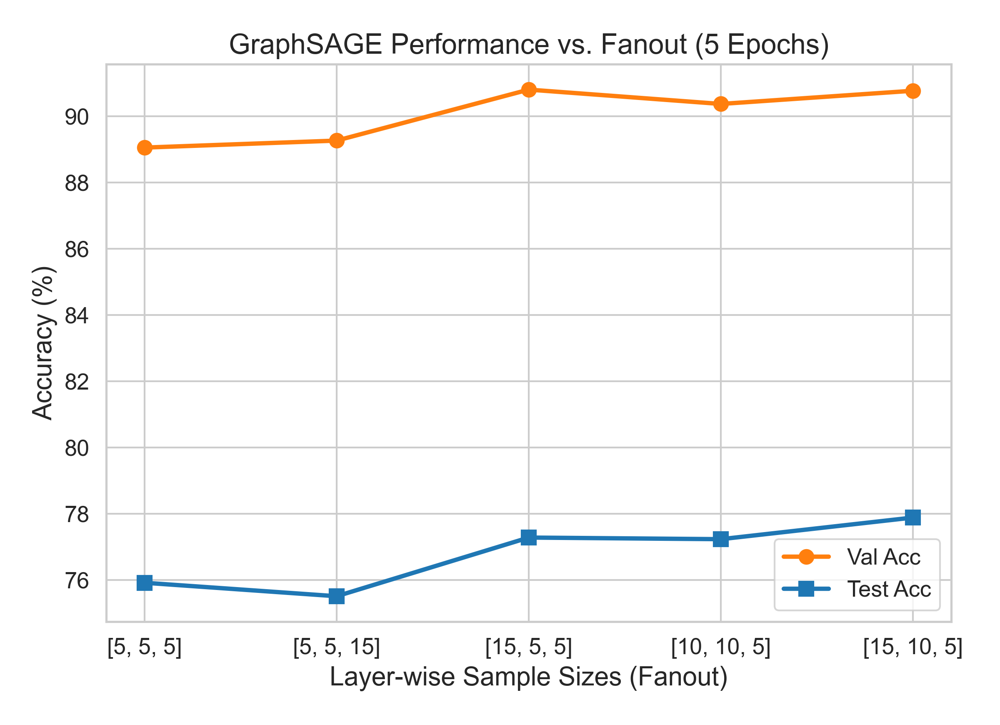
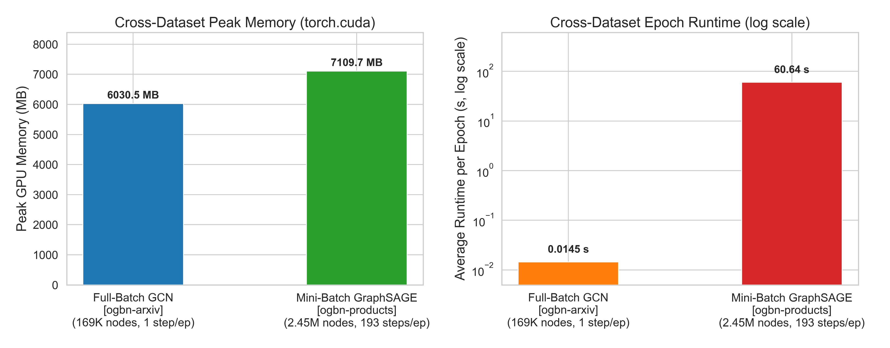

# CSC 591/791 Homework 2: GCN vs. GraphSAGE & Scalability Analysis
**Author**: Vaishvi Patel  
**Repository**: [https://github.com/vaishvi-code/CSC591-038-_hw2](https://github.com/vaishvi-code/CSC591-038-_hw2)  
**Date**: October 2026  

---

## Abstract
Graph Convolutional Networks (GCN) and GraphSAGE represent foundational paradigms in geometric deep learning. While full-batch GCN operates across the entire graph topology, it encounters steep memory scaling bottlenecks on large graphs. GraphSAGE addresses this via stochastic neighborhood sampling and mini-batch optimization. In this report, we evaluate full-batch GCN on `ogbn-arxiv` and mini-batch GraphSAGE on `ogbn-products`, demonstrating empirically that full-batch GCN encounters memory exhaustion on million-scale graphs and providing theoretical justification for why stochastic sampling resolves this bottleneck. We examine model depth, learning rates, mini-batch sizes, and neighbor sampling budgets under controlled training budgets, providing empirical profiling of runtime efficiency and GPU memory allocation alongside formal scalability bounds.

---

## 1. Task 1: Full-Batch GCN Reproduction & Convergence (`ogbn-arxiv`)

### 1.1 Experimental Configuration
Full-batch GCN was evaluated on the `ogbn-arxiv` citation network ($|V| = 169,343$, $|E| = 1,166,243$, 40 subject classes). The baseline architecture employs a 3-layer GCN with hidden dimension $d = 256$, batch normalization, dropout $p = 0.5$, and ReLU activations, trained with Adam and a constant learning rate ($\eta = 0.01$). The baseline converged over 100 epochs, while all hyperparameter sensitivity runs were executed under a standardized 80-epoch budget.

### 1.2 Convergence Dynamics
GCN exhibits rapid loss reduction during the initial 40 epochs (training loss declining from $4.21$ to $1.05$). In the first 15 epochs, validation accuracy exhibits visible oscillation, likely reflecting batch normalization statistics stabilizing under full-batch gradient steps. A modest train--validation gap emerges in later epochs (evaluated training accuracy with dropout inactive reaches $73.59\%$ while validation accuracy plateaus at $71.82\%$), reflecting mild overfitting typical of citation networks without label-propagation regularization. Following these dynamics, validation accuracy stabilizes around epoch 70. The reference 100-epoch baseline run reaches a peak validation accuracy of **71.82%** and a test accuracy of **71.30%** (Figure 1). Evaluating across 5 random seeds (seeds 42--46) to quantify run-to-run variation yields a mean validation accuracy of $71.92\% \pm 0.10\%$ and mean test accuracy of **71.16% $\pm$ 0.26%** (the reference run is a separate execution from the 5-seed set; standard GPU nondeterminism accounts for minor variance between individual seed-42 executions). This falls within $\approx 0.6$ pp of the official Open Graph Benchmark (OGB) leaderboard baseline ($71.74\% \pm 0.29\%$), demonstrating robust reproduction despite training for 100 epochs versus the reference 500 epochs.

*Figure 1: Training, validation, and test loss and accuracy curves for 3-layer GCN on `ogbn-arxiv` over 100 epochs.*

---

### 1.3 Hyperparameter Sensitivity Analysis

| Configuration | Best Val Acc (%) | Best Test Acc (%) | Peak Memory (MB) | Avg Epoch Time (s) |
| :--- | :---: | :---: | :---: | :---: |
| Depth $L = 2$ | 70.55% | 69.66% | 5,445.7 MB | 0.0100 s |
| Depth $L = 3$ (80 ep, ref) | 71.49% | 70.88% | 6,030.5 MB | 0.0145 s |
| *Depth $L = 3$ (100 ep base)* | *71.82%* | *71.30%* | *6,030.5 MB* | *0.0145 s* |
| **Depth $L = 4$** | **71.60%** | 70.65% | 6,616.2 MB | 0.0156 s |
| Depth $L = 5$ | 71.04% | 70.08% | 7,201.7 MB | 0.0189 s |
| Depth $L = 6$ | 70.32% | 69.72% | 7,788.0 MB | 0.0223 s |
| LR $\eta = 0.001$ | 68.91% | 67.71% | 6,030.5 MB | 0.0146 s |
| **LR $\eta = 0.005$** | **71.63%** | 70.87% | 6,030.5 MB | 0.0135 s |
| LR $\eta = 0.010$ (80 ep, ref) | 71.49% | 70.88% | 6,030.5 MB | 0.0145 s |
| LR $\eta = 0.050$ | 69.33% | 68.17% | 6,030.5 MB | 0.0132 s |

  
  

*Figure 2: GCN accuracy across model depths (left) and learning rates (right).*

#### Discussion:
- **Impact of Model Depth ($L$)**: Increasing depth from $L=2$ to $L=3$ expands the receptive field to 3 hops, improving test accuracy by $1.22$ pp ($69.66\% \to 70.88\%$). This gain is $\approx 4.7\times$ the observed test standard deviation ($\sigma_{\text{test}} \approx 0.26$ pp), supporting the receptive-field expansion benefit. Selecting on validation accuracy, $L=4$ yields the highest value ($71.60\%$ val, $70.65\%$ test), marginally outperforming $L=3$ ($71.49\%$ val); the $0.11$ pp gap is comparable to the observed validation variation ($\sigma_{\text{val}} \approx 0.10$ pp) and consistent with run-to-run noise. In contrast, the drop from $L=4 \to L=6$ ($1.28$ pp val) exceeds the observed seed-to-seed std ($\approx 0.10$ pp) by an order of magnitude, suggesting genuine degradation rather than noise. We hypothesize that this performance drop stems from a combination of optimization challenges (such as gradient attenuation across deep stacks) and early oversmoothing. Specifically, the propagation rule repeatedly averages representations over expanding neighborhoods, progressively smoothing node feature variance toward stationary eigenvectors proportional to $\sqrt{\tilde{d}_i}$. While batch normalization stabilizes layer activations against internal covariate shift, it may not fully counteract Dirichlet energy decay across distant hops. Peak allocated memory (`torch.cuda.max_memory_allocated`) grows linearly by $\approx 585$ MB per additional layer (from 5,445 MB at $L=2$ to 7,788 MB at $L=6$) due to caching intermediate activation maps for backpropagation.
- **Impact of Learning Rate ($\eta$)**: A small learning rate ($\eta = 0.001$) converges slowly within 80 epochs ($68.91\%$ val), while an aggressive rate ($\eta = 0.05$) exhibits gradient variance and plateaus at $69.33\%$ val. The val-optimal setting is $\eta = 0.005$ ($71.63\%$ val); however, the test gap versus $\eta = 0.01$ is only $0.01$ pp ($70.87\%$ vs. $70.88\%$)---well below the empirical test noise threshold ($\sigma \approx 0.26$ pp). Small runtime variations ($0.013$--$0.015$s) reflect host scheduling noise.

---

## 2. Task 2: Mini-Batch GraphSAGE & Neighborhood Sampling (`ogbn-products`)

### 2.1 Experimental Configuration
GraphSAGE was evaluated on the large-scale `ogbn-products` graph ($|V| = 2,449,029$, $|E| = 61,859,140$, 47 classes). The baseline utilizes 3 layers ($d = 256$), mean aggregation, dropout $p = 0.5$, and batch normalization.

### 2.2 Convergence & Replication
GraphSAGE converged steadily over 15 epochs (Figure 3), achieving **91.61%** validation accuracy and **78.61%** test accuracy, within $0.1$ pp of the official OGB benchmark ($78.70\% \pm 0.36\%$). The notable validation-test gap ($91.61\%$ vs. $78.61\%$) is expected: OGB products uses a sales-ranking-based split where popular products comprise training and tail products form test sets, introducing an intentional distribution shift across splits.

*Figure 3: GraphSAGE training loss and accuracy curves (train, val, test) on `ogbn-products` ($B=1024, S=[15,10,5]$).*

---

### 2.3 Sampling Hyperparameter Investigation

| Configuration | Best Val Acc (%) | Best Test Acc (%) | Peak Memory (MB) | Avg Epoch Time (s) |
| :--- | :---: | :---: | :---: | :---: |
| Batch $B = 512$ | **90.80%** | 76.45% | 7,113.8 MB | 66.29 s |
| Batch $B = 1024$ (5 ep, ref) | 90.77% | **77.89%** | **7,109.7 MB** | 59.45 s |
| *Batch $B = 1024$ (15 ep base)* | *91.61%* | *78.61%* | *7,109.7 MB* | *60.64 s* |
| Batch $B = 2048$ | 90.62% | 77.33% | 9,393.7 MB | **49.94 s** |
| Fanout $S=[5, 5, 5]$ | 89.05% | 75.92% | **3,735.0 MB** | **16.92 s** |
| Fanout $S=[5, 5, 15]$ | 89.27% | 75.52% | 5,539.7 MB | 35.35 s |
| Fanout $S=[15, 5, 5]$ | **90.80%** | 77.29% | 5,454.2 MB | 37.31 s |
| Fanout $S=[10, 10, 5]$ | 90.37% | 77.24% | 6,152.9 MB | 46.77 s |
| Fanout $S=[15, 10, 5]$ (5 ep, ref) | 90.77% | **77.89%** | 7,109.7 MB | 59.45 s |

*(Note: bold indicates best value among 5-epoch ablations; italics indicates 15-epoch base reference; single seed 42)*

  
  

*Figure 4: GraphSAGE sensitivity to mini-batch size (left) and neighbor fanout (right).*

#### Discussion:
- **Impact of Batch Size ($B$)**: Increasing batch size from 512 to 2048 decreases epoch runtime from $66.29$s to $49.94$s. With 196,615 training nodes, larger batches reduce total iteration steps per epoch ($\approx 385$ steps at $B=512$, $\approx 193$ at $B=1024$, and $\approx 97$ at $B=2048$), amortizing loop overhead and GPU kernel launch latency. Peak allocated memory remains nearly identical between $B=512$ and $B=1024$ ($\approx 7,110$ MB); because peak memory was tracked across the combined training and evaluation loop without a reset between phases, this flat memory plateau most likely reflects an eval-dominated peak memory confound ($B_{\text{eval}} = 4096$) that overshadows training differences at smaller batches. At $B=2048$, the larger training multi-hop union frontier finally exceeds the evaluation footprint, elevating peak memory to $9,393.7$ MB. By validation accuracy, $B=512$ marginally leads ($90.80\%$ vs. $90.77\%$); the difference is within single-seed noise and the two configurations are effectively indistinguishable.
- **Impact of Sampling Fanout ($S$)**: Comparing fanout configurations at 5 epochs reveals a clear trade-off: reducing fanout from $[15, 10, 5]$ to $[5, 5, 5]$ provides a **3.5$\times$ speedup** ($59.45$s $\to 16.92$s) and reduces peak allocated memory by $47\%$ ($7,109.7$ MB $\to 3,735.0$ MB), at the cost of a $1.97$ pp drop in test accuracy ($77.89\% \to 75.92\%$). Crucially, evaluating asymmetric layer-wise budgets with identical total path products ($15 \times 5 \times 5 = 5 \times 5 \times 15 = 375$ paths) isolates the role of hop placement: front-loading the budget at hop 1 ($S=[15, 5, 5]$) achieves $90.80\%$ val and $77.29\%$ test in $37.31$s, whereas back-loading at hop 3 ($S=[5, 5, 15]$) yields $89.27\%$ val and $75.52\%$ test ($1.77$ pp test deficit). Dense sampling at immediate neighbors captures vital local graph topology, whereas heavy 3rd-hop sampling aggregates diluted features across distant nodes. Empirically, a rough linear fit ($n=5$ configs) indicates approximately linear scaling with sampled path product according to $M \approx 2.9\text{ GB} + (\text{path product} \times 5.6\text{ MB})$, predicting $\approx 5.0\text{ GB}$ for the 375-path configurations (measured $\approx 5.5\text{ GB}$) and $\approx 5.7\text{ GB}$ for 500 paths (measured $6.15\text{ GB}$); this reflects sampled batch tensors atop a fixed baseline of framework context, static indexing, and evaluation buffers.

---

## 3. Task 3: Comparative Profiling & Scalability Discussion

### 3.1 Empirical Profiling Comparison

| Metric | Full-Batch GCN | Mini-Batch GraphSAGE |
| :--- | :---: | :---: |
| **Dataset** | `ogbn-arxiv` | `ogbn-products` |
| **Graph Scale ($|V|, |E|$)** | 169K nodes, 1.16M edges | **2.45M nodes, 61.8M edges** |
| **Training Steps per Epoch** | 1 step (full graph) | $\approx 193$ steps (mini-batch) |
| **Time per Step** | $\approx 14.5$ ms | $\approx 310$ ms |
| **Time per Epoch** | $0.0145$ s | $60.64$ s ($16.92$ s for $[5,5,5]$) |
| **Measured Peak GPU Mem** | 6,030.5 MB | 7,109.7 MB (3,735.0 MB for $[5,5,5]$) |
| **Empirical Test on Products** | Out-Of-Memory (OOM) | Runs stably |
| **Slope Extrapolation on Products** | $\approx 25.5$ GB (Activations) | N/A (Fits on 15 GB GPU) |
| **Test Accuracy$^\dagger$** | 71.16% $\pm$ 0.26% (arxiv, 5-seed) | 78.61% (products, 15 ep, single seed) |

$^\dagger$*Cross-benchmark accuracies are non-comparable directly due to differing task domains.*

*Figure 5: Comparative peak GPU memory and epoch runtime across paradigms on their respective benchmarks.*

Because the two paradigms operate on different benchmarks, the runtime per epoch reflects both algorithm and dataset scale: full-batch GCN completes an epoch in a single $14.5$ ms gradient step on `ogbn-arxiv`, while mini-batch GraphSAGE performs $\approx 193$ sequential sampled steps per epoch on `ogbn-products`.

---

### 3.2 Hardware Scaling & Slope-Based Extrapolation
On `ogbn-arxiv`, Table 1 demonstrates that full-batch GCN activation memory increases by $\approx 585$ MB per layer for 169K nodes. When scaling to `ogbn-products` ($2.45\text{M}$ nodes, a $14.5\times$ increase in $|V|$ at fixed hidden dimension $d = 256$), the activation memory slope scales proportionally with $|V|$:
$$\Delta M_{\text{layer}} \approx 585\text{ MB} \times 14.5 \approx 8.5\text{ GB per layer}$$
For a 3-layer model, caching activations alone requires an estimated $\approx 25.5\text{ GB}$ (a lower bound: the slope excludes the unattributed baseline overhead of $\approx 4.3$ GB extrapolated to $L=0$ from Table 1, representing PyTorch runtime context and full-graph evaluation buffers, while static graph tensors themselves account for only $\approx 100$ MB; note that if parts of this baseline scale with $|V|$, such as full-graph evaluation buffers, the $25.5$ GB estimate is a conservative lower bound, further reinforcing the OOM result). Adding the symmetrized `edge_index` for 61.8M undirected edges ($123.7\text{M}$ directed pairs $\times 2$ rows $\times 8$ bytes $\approx 1.98\text{ GB}$) and intermediate aggregation buffers pushes the true requirement well beyond 30 GB. When executing full-batch GCN on `ogbn-products` on an NVIDIA Tesla T4 GPU (15.0 GB VRAM), PyTorch immediately halts with a `torch.cuda.OutOfMemoryError` (log in `results/oom_log.txt`). In contrast, mini-batch GraphSAGE trains stably on the same GPU, consuming $7.1$ GB VRAM (and only $3.7$ GB under $[5,5,5]$).

---

### 3.3 Theoretical Scalability Analysis: Resolving Neighborhood Explosion
The memory divergence arises from the receptive field expansion during backpropagation:

#### Full-Batch Activation Bottleneck:
Full-batch GCN computes layer activations globally: $H^{(l+1)} = \sigma(\tilde{A}_{\text{norm}} H^{(l)} W^{(l)})$. Exact gradient computation requires retaining all intermediate activation tensors $\{H^{(0)}, \dots, H^{(L)}\}$, imposing an $\mathcal{O}(L \cdot |V| \cdot d)$ memory footprint.

Furthermore, naive node-wise mini-batching without sampling fails due to exponential receptive field growth. In real-world graphs exhibiting power-law degree distributions (average degree $d_{\text{avg}} = 2|E|/|V| \approx 50.5$, or $\approx 25.3$ undirected edge pairs per node on `ogbn-products`), an unconstrained $L$-hop receptive field expands exponentially. For $L=3$, the branching paths from a single seed expand as $(50.5)^3 \approx 1.28 \times 10^5$; across a mini-batch of $B = 1024$ seed nodes, the union of overlapping receptive fields can cover a large fraction of the active graph.

#### Stochastic Neighborhood Sampling:
GraphSAGE restricts neighbor aggregation to a fixed sample budget $S_l$ at each hop $l \in \{1, \dots, L\}$. For a mini-batch of $B$ seed nodes, the outermost layer frontier is strictly bounded by:
$$|\mathcal{V}_L| \le B \cdot \prod_{l=1}^L S_l$$
while the total number of sampled nodes across all layers is bounded by $B \left(1 + \sum_{l=1}^L \prod_{i=1}^l S_i\right) = B(1 + S_1 + S_1 S_2 + \dots)$. This bounds per-step backpropagation activation memory to $\mathcal{O}\left(B \cdot d \cdot \sum_{l=1}^L \prod_{i=1}^l S_i\right)$, which is asymptotically dominated by the outermost frontier $\mathcal{O}(B \cdot d \cdot \prod_{l=1}^L S_l)$. While static node features and sampler indexing occupy a fixed GPU memory baseline ($\approx 980\text{ MB}$ for features in our setup, or CPU host memory in out-of-core pipelines), GPU activation memory during backpropagation is decoupled from total graph size $|V|$, enabling scalable representation learning on graphs of arbitrary magnitude.

---

## 4. Reproducibility & Environment Details
Experiments were executed on an NVIDIA Tesla T4 GPU (15.0 GB VRAM, 2 vCPUs) with Python 3.11, PyTorch 2.11, PyG 2.4.0, and OGB 1.3.6 under fixed seed 42. GCN step times use `torch.cuda.synchronize()`; GraphSAGE epoch times reflect sampling and training (excluding periodic evaluation passes). Multi-process loaders (`num_workers=4`) on 2 vCPUs introduce sampling bottlenecks due to CPU oversubscription. Training scripts, reproduction commands, logs, and OOM traces are in the GitHub repository ([https://github.com/vaishvi-code/CSC591-038-_hw2](https://github.com/vaishvi-code/CSC591-038-_hw2)).

---

## 5. Conclusion
This study reproduced GCN and GraphSAGE on OGB benchmarks. On validation accuracy, $L=4$ and $\eta=0.005$ led the GCN ablation grid, while $S=[15,5,5]$ achieved the highest validation accuracy ($90.80\%$) and faster runtime ($37.3$s) for GraphSAGE, with $S=[15,10,5]$ offering highest test accuracy ($77.89\%$). Mid-range configurations ($L \in \{3,4\}$, $\eta \in \{0.005, 0.01\}$, $B \in \{512, 1024\}$) show validation gaps below $0.2$ pp, within empirical run-to-run variation ($\sigma \approx 0.10$ pp). Profiling confirms that stochastic neighborhood sampling bounds the backpropagation frontier and resolves receptive field explosion, enabling scalable mini-batch training where full-batch GCN encounters out-of-memory limits.
